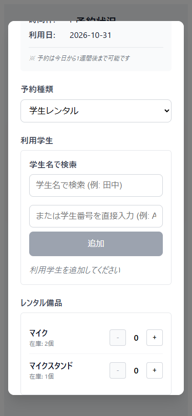
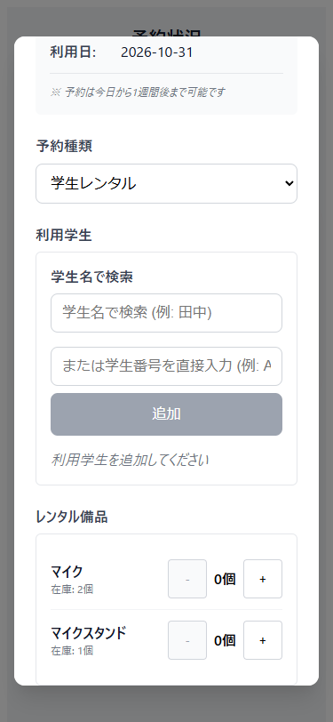

# 予約入力で備品の数量を選ぶ操作

2026-10-31に、ユーザーPCのEdgeをPlaywrightからheadlessで起動して確認した。PR #41の`c997c8245a00494bace305d928af25675ea06066`を基点にし、PR #30のレビュー修正や既存UIの変更には触れていない。APIは架空データに置き換えた。

## 確認した問題と変更

予約入力で複数の備品を表示すると、数量ボタンの名前はすべて「+」「-」だった。備品名を含む名前でボタンを探すテストは失敗した。ボタンは32px四方で、狭い画面で繰り返し操作するには小さかった。

備品名と増減の動作をボタンの名前に含め、現在の選択数量を備品別のoutputで伝えるようにした。見える数量には「個」を付けた。操作領域は44px四方に広げ、長い備品名は折り返して操作部分と重ならないようにした。18〜20歳の学生を想定した操作改善だが、対象学生によるユーザーテストは実施していない。

## 参考資料

[W3C Name, Role, Value](https://www.w3.org/WAI/WCAG22/Understanding/name-role-value.html)で、操作の名前・状態・値をプログラムから判別できることを確認した。[W3C Target Size (Minimum)](https://www.w3.org/WAI/WCAG22/Understanding/target-size-minimum.html)を操作領域の参考にした。AAの最低基準は24pxで、今回の44pxは押しやすさを高めるための目標である。両資料は2026-10-31に参照し、画像・ロゴ・画面は複製していない。

## 設計と範囲

| 提案ID | 責務・配置 | 依存・契約 | 理由とトレードオフ |
|---|---|---|---|
| PROP-equipment-controls | BookingDialogの表示層で備品別の操作名、数量の伝達、配置を扱う | 既存Equipmentのname・stockと画面内の選択数量を表示する。数量の増減処理やHTTP通信は変更しない | 既存のbuttonとoutputで表現でき、新しい業務型や共通部品は不要。ボタン拡大により長い名前では縦に場所を使う |

[用語帳](ユビキタス言語帳.md)の「備品」「在庫」「予約数量」と照合した。「選択数量」は入力中の値の説明であり、新しい業務状態を導入していない。0個からAPIが返す在庫数までの既存の操作範囲と、0個の明細を送信しない処理を維持した。数量100個の上限、引当期間、承認、権限など未回答の業務条件は変更していない。

## TDDと検証

| サイクル | 実際のRed | 最小変更後のGreen |
|---|---|---|
| 1 | 備品名で数量ボタンを見つけられない | 備品名と増減操作をaria-labelへ追加。1件成功 |
| 2 | 備品別の数量を表すstatusが見つからない | 数量を名前付きoutputで表示。2件成功 |
| 3 | 320px幅でボタンが44pxの目標を満たさない | ボタンの拡大と備品行の折返し。3件成功 |

補足として在庫0個、キャンセル・Escape後のリセットと未送信、503からの再試行と送信明細、ブラウザの戻る・進むを追加した。初回全体実行では、503の準備処理が成功時の一覧を待ってtimeoutになった。独立レビューのFIND-error-fixture-scrollに従い、常にある備品セクションへスクロールするよう修正した。このテスト準備の不備は製品のRed/Green回数に含めない。Refactorでは既存数量処理との責務の境界と重複を点検し、追加の抽象化は行わなかった。

最終のUIテストは27件成功した。今回7件と既存20件を含む。Vite buildも成功した。375pxの改善前後を目視確認し、320pxで長い備品名と44pxのボタンが収まること、Enter・Space・連続増減、0個と在庫上限での無効化、別備品の数量が変わらないことを確認した。

別タスクに干渉しないよう、独立したブラウザコンテキストと専用ポート5187でViteを起動した。既存サーバーは再利用せず、他のブラウザ・デスクトップ・プロセスは操作していない。検証用の一時設定は、既存Playwright設定のbaseURLとwebServerを5187へ変更し、reuseExistingServerをfalse、workersを1にしたもので、製品差分には含めない。通常の再実行はstudio-frontendで`npm ci`後に`npm run test:ui -- --reporter=line`と`npm run build`を使う。

型検査・lintの専用スクリプトとvue-tsc依存がないため未実施。buildの成功を型検査成功とは扱わない。実API、実機スマートフォン、スクリーンリーダー、Safari・Firefoxは未検証。読み上げ自体の確認はしていない。バックエンドは変更せず、テストを再実行していない。既存UIテストの一部には備品APIの接続失敗ログが出るが、全27件は成功している。CIは未設定。

生ログは作業領域の`review-artifacts/equipment-01-red.log`〜`equipment-03-green.log`、`equipment-final-tests.log`、`equipment-final-build.log`に保存した。

## 改善前後

| 変更前 | 変更後 |
|---|---|
|  |  |

## レビュー方法

予約入力で複数の備品を表示し、ボタンのアクセシブルな名前に備品名と増減動作が含まれることを確認する。Enter・Spaceで数量を増減し、別備品の数量を変えず、0個と在庫数で操作が無効になれば合格とする。320pxでは長い備品名を使い、ボタンが画面からはみ出さないことを確認する。

tests/equipment-controls.spec.tsでキャンセル後のリセット、POST未送信、503後の再試行、送信する備品IDと数量を確認する。PR #41をbaseとする今回分の差分だけが対象で、統合時には未マージのPR #41への依存を確認する。
