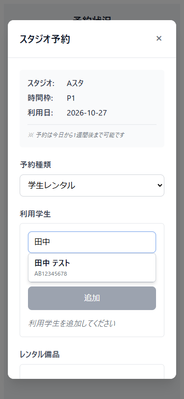
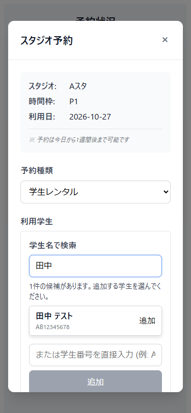

# 予約入力で学生を検索して追加する操作

2026-10-27 UTCに、ユーザーPCのEdgeをPlaywrightからheadlessで起動して確認した。ローカルViteの実画面を使い、APIは架空データへ置き換えた。PR #40のコミット`3e198a743afcc7ae3d310b22617a3fe81e598255`を基点とし、前回のモーダル改善と重複しない差分にした。

## 実画面で確認した問題

予約入力で学生名を検索すると候補は表示されたが、Tabでは候補へ移れなかった。候補がクリックだけを受け付けるdivだったため、キーボードで検索しても学生を選べなかった。検索中・候補なし・通信失敗の区別も表示されず、入力を変えた後に古い検索結果が戻る問題もテストで再現した。

18〜20歳の学生がスマートフォンやキーボードで利用学生を選ぶ場面を想定し、この操作を改善した。対象学生によるユーザーテストは実施していない。

## 参考にした公開資料

- [W3C Keyboard](https://www.w3.org/WAI/WCAG22/Understanding/keyboard.html)を、ポインターでできる選択をキーボードでも行える基準にした。
- [W3C Status Messages](https://www.w3.org/WAI/WCAG22/Understanding/status-messages.html)を、検索中・候補件数・0件・失敗をフォーカス移動なしで伝える基準にした。
- [GOV.UK Button](https://design-system.service.gov.uk/components/button/)を、実行する動作が分かる「追加」ラベルの参考にした。

いずれも2026-10-27に参照した。配色や画面を複製せず、既存の入力画面に合わせた。検索結果は通常のボタンとしてTab・Enter・Spaceで操作する。矢印キーで候補を選ぶコンボボックスは導入していない。

## 設計と変更範囲

| 提案ID | 責務と配置 | 依存・契約 | トレードオフ |
|---|---|---|---|
| PROP-student-search-feedback | BookingDialogの表示層で検索状態と候補選択を扱う | 既存studentApiから受け取るStudentを表示し、選択後は入力へフォーカスを戻す。通信失敗を0件に見せない | ボタンを使うため操作が標準的になる一方、候補が多い場合はTab移動が増える |
| PROP-latest-student-search | 同じ表示層で検索要求の世代を管理する | 入力変更、クリア、選択、フォームの開閉、予約種類の変更、破棄で古い応答を無効にする。最新要求の成功・失敗だけ表示する | 通信自体は中止せず、不要になった結果の反映を抑止する |

HTTP呼出しは既存API関数、表示とDOMへの副作用はBookingDialogに置いた。新しい集約やドメインルールは追加していない。選択済み学生の除外と学生番号による重複防止は既存の処理を維持した。

[用語帳](ユビキタス言語帳.md)の「学生」「学生番号」「メンバー」と照合した。今回の検索状態は画面上の状態であり、業務上の予約状態ではないため用語追加は不要。参照権限、表示する個人情報、承認待ちの条件はIssue #31・#34・#35などで確認中であり、このPRでは決めていない。

## TDD記録

| サイクル | 実際に確認したRed | Green |
|---|---|---|
| 1 | Tab移動後、学生候補のbuttonが見つからず失敗 | 候補をbuttonにし、追加後の入力へのフォーカス復帰を追加。1件成功 |
| 2 | 検索中を伝えるstatusが見つからず失敗 | 検索中・件数・0件・失敗と再試行を表示。2件成功 |
| 3 | 古い検索結果が新しい候補を上書きして失敗 | 要求の世代を照合し、不要になった応答を反映しない。3件成功 |

その後の5件は最初から成功した補足検証で、Redの回数に含めない。クリア、キャンセル後の再表示、予約種類の変更、古い失敗応答、320pxでのSpace選択と重複除外を確認した。Refactorでは検索状態の初期化をresetStudentSearchにまとめ、同じ無効化処理を選択とフォームリセットから呼んでいる。

## 最終検証と限界

`studio-frontend`で`npm ci`後、`npm run test:ui -- --reporter=line`は20件成功した。今回の8件とPR #38・#40の12件を含む。`npm run build`も成功した。型検査・lintのスクリプトとvue-tsc依存は既存package.jsonにないため未実施。build成功を型検査成功とは扱わない。

375pxの変更前後を撮影して目視確認した。320pxでは候補ボタンが画面幅に収まり、幅・高さとも44px以上だった。Tab・Enter・Space、反復追加、キャンセル・Escape、検索中と503後の再試行、古い成功・失敗応答を確認した。既存回帰テストでブラウザの戻る・進むと再表示後の操作も確認した。キャンセルで予約POSTが送られないことを今回のテストでも確認している。

既存テストの一部は備品APIを置き換えておらず、Viteに接続失敗ログが出るが、全20件は成功している。実API接続、認証、メール、永続化、実機スマートフォン、スクリーンリーダー、Safari・Firefoxは未検証。バックエンドの変更はなく、バックエンドテストは再実行していない。CIは未設定。

生ログは作業領域の`review-artifacts/search-01-red.log`から`search-03-green.log`、`search-final-tests.log`、`search-final-build.log`に保存した。GitHubに含める証跡は、この記録、テストコード、次の画像である。

## 改善前後

| 変更前 | 変更後 |
|---|---|
|  |  |

## レビュー方法

学生名を入力し、Tabで候補へ移動してEnterまたはSpaceで追加する。追加後は入力へフォーカスが戻り、同じ学生を検索しても重複追加されないことを確認する。通信失敗時に0件と区別でき、入力を保ったまま再試行できれば合格とする。

遅い応答についてはtests/student-search.spec.tsの応答順制御を確認する。入力変更やキャンセル後に古い候補・エラーが戻らず、検索条件に合う最新表示を保つことを判定基準とする。PR #40への依存があるため、統合時にはbaseの扱いを確認する。
