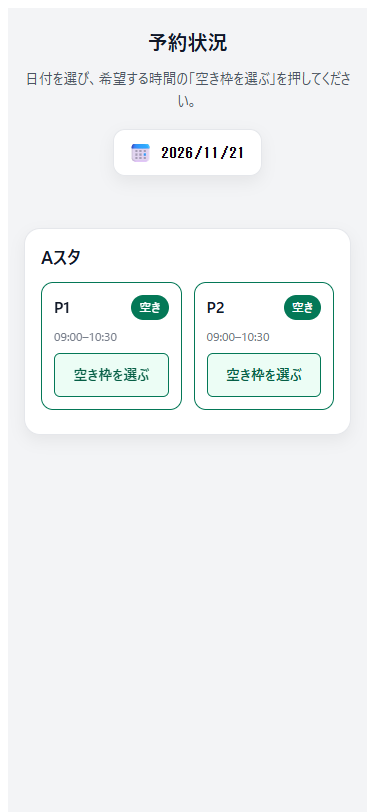
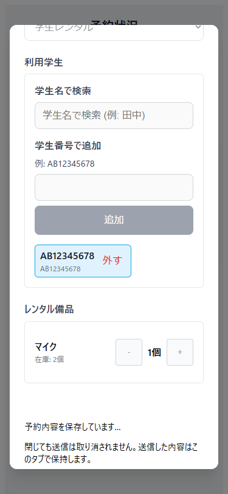

# 予約保存中と結果不明時の入力保持

## 問題と変更

375px幅のheadless Edgeで、POSTの応答を保留すると予約入力がすぐ閉じることを再現しました。エラー時には入力し直す必要があり、保存できたか不明な場合にも再試行を案内していました。

送信した入力を画面に残し、保存中・保存済み・結果不明を表示します。結果不明のときは再送を案内せず、入力を保持したまま送信を止めます。閉じる操作は送信取消ではありません。「送信した内容を表示」から同じ内容を確認できます。

| 応答保留時の変更前 | 変更後 |
|---|---|
|  |  |

保存済みになった後は一覧をGETで更新します。一覧の取得失敗は保存失敗に戻さず、一覧の再読込でもPOSTを繰り返しません。保存は承認や確定と区別し、「予約内容を保存しました」と表示します。

## ベースと設計

#44 のHEAD `97b0f03037c8e49f05debd1320f9fef304d04896` をベースにした変更です。最新masterとの差分を確認し、バックエンドに差分がないこと、#38・#40〜#44のUI改善が未マージであることを確認しました。既存のフォーカス・検索・入力操作を保持するため、#44に依存するPRとして分けます。#39の承認機能は取り込みません。指定された#72は認証済みAPIでも404で、内容を確認できませんでした。

| proposal_id | 責務と依存 | 契約 | 理由とトレードオフ |
|---|---|---|---|
| PROP-save-session | フロントエンドの送信状態が入力とAPI呼出しを保持。画面は状態を表示し、APIアダプターが応答を検証 | 同時に1件だけ送信。成功応答の構造と送信対象が一致する場合だけ保存済みにする | router内の移動でも状態を保持できる。結果不明の間は新しい予約入力も開始できない |
| PROP-save-calendar | SchedulePageが保存済みの後に一覧を取得 | GET失敗で保存済みを覆さず、POSTし直さない | 保存と一覧表示の失敗を区別できる |

これは表示と通信の状態で、ドメインの予約状態ではありません。集約・承認・通知・取消の仕様は変えていません。「学生」「予約種類」「備品」「イベント名」は既存用語と照合しています。新しい業務用語の登録はありません。

## 未確定の契約と保持範囲

現在の400・409も保存後の処理で返る可能性があり、書き込み前の拒否を保証する機械判定用コードはありません。今回はすべてのエラーと解釈不能な成功応答を結果不明として扱い、安全な再試行の条件は[質問Issue #45](https://github.com/cardamon04/music-studio-reservation/issues/45)に分けました。空き枠の変化で本人の保存を推定しません。

入力保持はこのタブのメモリ内だけです。router内の移動では残りますが、ページの再読み込み・タブを閉じる操作・別タブへの移動では保持や重複防止を保証しません。localStorageやsessionStorageは使いません。

## 参考資料

- [GOV.UK Error message](https://design-system.service.gov.uk/components/error-message/): 入力を消さず残す方針を参考にしました。利用者が修正できない通信の問題は、入力欄の検証エラーとして表示しません。
- [W3C Status Messages](https://www.w3.org/WAI/WCAG22/Understanding/status-messages.html): フォーカスを奪わず状態の変化を通知するため、状態文にrole=statusを使います。
- [W3C Modal Dialog](https://www.w3.org/WAI/ARIA/apg/patterns/dialog-modal/): Escape・Tab操作・閉じた後のフォーカス復帰を既存実装と照合しました。

いずれも一般的な操作とアクセシビリティの資料で、18〜20歳特有の好みを実証する資料ではありません。

## 検証方法

ユーザーPCのheadless Edgeで、専用ポート5191のViteとモックAPIを使いました。実予約は行っていません。

1. 375px幅で学生と備品を選び、POSTの応答を保留します。入力と保存中の表示が残り、連打とEnterでもPOSTが1件のままであることを確認します。
2. 503・通信断・400・409・空の成功応答・JSON以外・異なる枠の応答・202受付応答を返します。結果不明の表示、入力保持、再送不可を確認します。イベント名と予約種類も保持することを確認します。
3. 送信中にEscapeで閉じてrouter内を移動し、遅い成功応答を返します。戻る・進むの後に同じ学生・備品を確認し、備品GETが失敗しても数量が見えることを確認します。
4. 保存成功後のカレンダーGETだけを503にします。一覧の再読込でPOSTが増えず、保存済みの表示を失敗に変えないことを確認します。
5. 320px幅で横にはみ出さず、閉じる・再表示のフォーカスが戻ることを確認します。成功時も送信ボタンのフォーカスを失わないことを確認します。
6. 旧画面の備品GETを保留し、復帰後の新画面で1個選択します。旧応答が空一覧でも、新画面の備品と数量が消えないことを確認します。

TDDでは最初の3件と、独立再レビューで追加した古い備品応答と202応答の計2件が変更前に失敗しました。残りの8件は補足回帰テストです。最初のモック設定ミスと、状態文のselector重複による失敗は製品のRedに数えていません。

修正後の製品コードで、既存39件と新規13件のUIテスト計52件、および `npm run build` が成功しました。

型検査・lintは専用スクリプトがなく未実施です。buildを型検査として扱いません。実APIとの結合、実機スマートフォン、音声読み上げ、学生によるユーザーテストは未実施です。既存scheduleテストにはモック未設定の備品GET接続拒否ログがあります。バックエンドは変更していないため、そのテストは対象外です。
