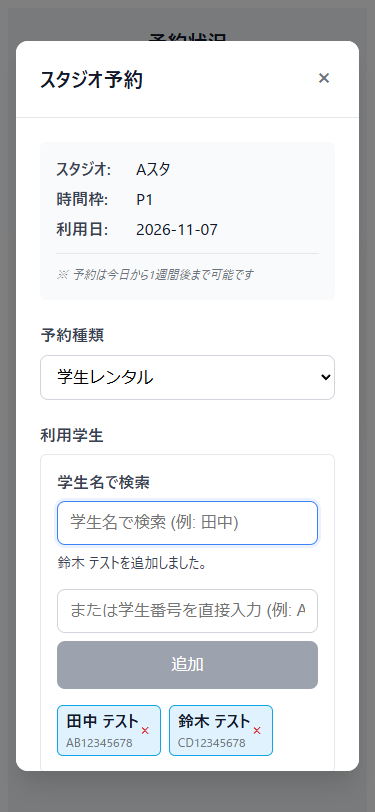
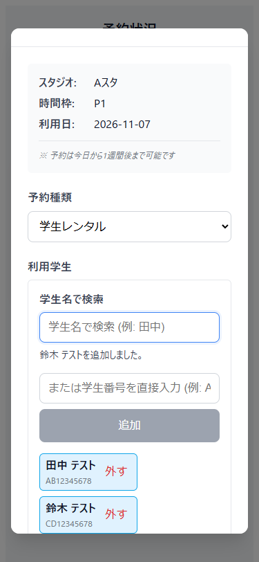

# 利用学生を選択から外す操作の改善

2026年11月7日。PR #42のHEAD `102bb898a6346fda276ebcf2a358ae4aa0221269` を基準に確認しました。既存PRの学生検索と備品操作を維持し、予約フォーム内の選択解除を改善します。

## 問題と変更

変更前の375px画面では、選択した学生の横に小さな「×」だけがありました。読み上げ時に対象学生と操作を区別する名前がなく、末尾の学生を外すとキーボードのフォーカスも失われました。

ボタンには「外す」と表示し、アクセシブル名を「氏名 学生番号 を選択から外す」にしました。操作領域は44px以上です。外した後は次の学生、次がなければ前の学生のボタンにフォーカスを移し、選択が空になった場合は学生名の検索欄へ戻します。長い名前は320px幅でも折り返します。

学生情報の削除や予約取消は行いません。予約の成立条件、選択できる学生、権限、承認、APIの契約は変更していません。用語集の学生・学生番号・予約メンバーに照合し、新しいドメイン用語は追加していません。

## 根拠

- [GOV.UK Button](https://design-system.service.gov.uk/components/button/) の、ボタン名で操作を説明する方針を参考にしました。
- [WCAG Focus Order](https://www.w3.org/WAI/WCAG22/Understanding/focus-order.html) の操作可能な順序を保つ考え方に沿い、選択解除後の移動先を決めました。次・前・検索の具体的な順序はこの画面での設計判断です。
- [WCAG Target Size Minimum](https://www.w3.org/WAI/WCAG22/Understanding/target-size-minimum.html) は24pxを基準とする要件です。今回の44pxは既存の検索・備品ボタンに合わせた操作領域で、AA要件が44pxという意味ではありません。

18〜20歳の利用者による評価は実施していません。公開サイトの画像・ロゴ・画面は複製していません。

## 設計

| 提案ID | 責務 | 採用内容 |
| --- | --- | --- |
| P-01 | UIの表示 | 対象と選択解除を説明する名前と操作領域をBookingDialogに置く |
| P-02 | UIの副作用 | Vueの描画完了後に隣接ボタンまたは検索欄へフォーカスする |
| P-03 | 行の同一性 | 既存の学生番号をkeyに使い、別学生のDOMを再利用しない |

DDDの業務判定や集約の変更はありません。画面上のフォーカスをドメイン層へ持ち込まず、既存の選択配列とAPI送信処理を維持しました。

## 検証記録

| 順序 | 期待 | 変更前 | 最小変更後 |
| --- | --- | --- | --- |
| 1 | 学生ごとに選択解除の名前を持つ | 1件失敗 | 1件成功 |
| 2 | 次・前・検索へフォーカスが移る | 1件失敗、1件成功 | 2件成功 |
| 3 | 320pxの長名表示と44px操作領域 | 1件失敗、2件成功 | 3件成功 |

生ログは作業PCの `review-artifacts/member-01-red.log` から `member-03-green.log` に保存しています。反復操作、キャンセル、通信503からの再試行、ブラウザの戻る・進むは補足の回帰確認です。補足テストの初回にはボタン名と履歴の作り方の誤りがあり、製品コードを変えずにテストを修正しました。この失敗はTDDのRedに含めません。

最終コードで既存27件と今回6件の画面テストがすべて成功し、Vite buildも成功しました。ユーザーPCの独立したheadless Edgeで、専用ポート5188、既存サーバーの再利用なしで実施しています。APIはモックです。実バックエンドへの保存、実機タッチ操作、スクリーンリーダーの音声確認は未実施です。型検査・lint専用のnpm scriptはなく、Vite buildは独立した型検査の代替にはなりません。

## 画面エビデンス

変更前と変更後は同じ375px幅の架空の学生データです。変更後は操作領域を確保したため、学生の行が縦に並びます。

