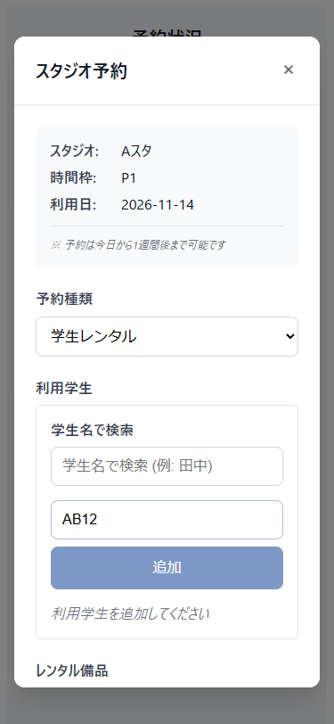
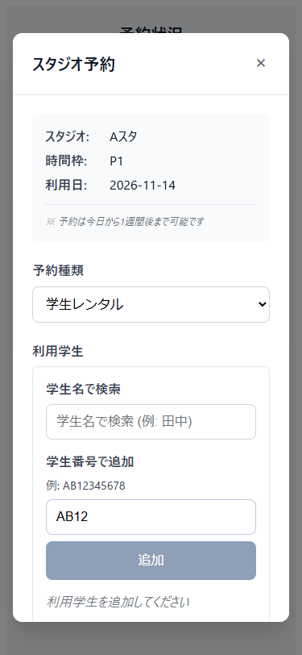

# 学生番号の入力案内

## 問題と変更

予約画面で学生番号を直接入力すると、項目名と入力例を兼ねたプレースホルダーが消えていました。375px幅のEdgeで「AB12」を入力した変更前の画面でも確認しました。

「学生番号で追加」というラベルと「例: AB12345678」を入力欄の外に表示しました。ラベルは入力欄に、例は `aria-describedby` で入力欄の説明に関連付けています。

| 変更前 | 変更後 |
|---|---|
|  |  |

デジタル庁の[インプットテキストのアクセシビリティ](https://design.digital.go.jp/dads/components/input-text/accessibility/)は、入力中も確認できるサポートテキストに入力例を置くよう説明しています。この根拠を今回の入力欄に適用しました。18〜20歳の学生に特有の好みを実証する資料ではありません。

## 設計の範囲

| proposal_id | 設計案・責務 | 依存・契約 | 理由とトレードオフ |
|---|---|---|---|
| PROP-student-number-guidance | BookingDialogの表示にラベルと例を配置 | 入力値、学生追加、予約送信の処理とAPI契約は既存のまま | 表示だけの改善をPresentationに閉じる。縦の表示領域は増えるため狭い画面でも確認する |

集約、トランザクション、ドメイン型の追加は不要です。用語帳の「学生番号」と既存例「AB12345678」に一致しています。新しい業務用語や形式検証は追加していません。

## レビュー手順

1. `/schedule` の空き枠から予約入力を開き、学生番号欄に「AB12」を入力します。項目名と例が残ることを確認してください。
2. 「学生番号で追加」のラベルをクリックします。入力欄にフォーカスすることが判定基準です。
3. 320px、375px、1280px幅で入力欄と案内、追加ボタンを確認します。横にはみ出さず、追加まで操作できることを確認してください。
4. 空白のみの入力では追加できず、同じ番号を繰り返し追加しても学生が重複しないことを確認します。キャンセル後に開き直すと入力と選択が消えることも確認してください。

## 検証

ユーザーPCのheadless Edgeを独立したコンテキストで起動し、専用ポート5189のViteを使用しました。API応答は架空データに置き換えています。

- TDDのRedは新テスト1件。変更前にラベルで入力欄を取得できず失敗しました。表示を変更した後、同じテストがGreenになりました。
- 補足テスト5件は最初から成功しました。320px・375px・1280px、空白入力、連続追加、キャンセル、学生検索の503応答後の直接入力、戻る・進むを確認しています。
- UIテストは既存33件と新規6件の計39件が成功しました。ラベル、説明のアクセシビリティ上の関連付けも検査しています。
- `npm run build` は成功しました。
- 既存scheduleテストで備品APIへの接続拒否ログが出ています。39件のテストは成功していますが、実バックエンドとの疎通確認にはなりません。

型検査とlintはスクリプトがなく未実施です。buildを型検査の代わりにしていません。実バックエンドとの結合、実機スマートフォン、スクリーンリーダーによる音声読み上げ、学生を対象としたユーザーテストは未実施です。バックエンドは変更しておらず、そのテストは今回の対象外です。
